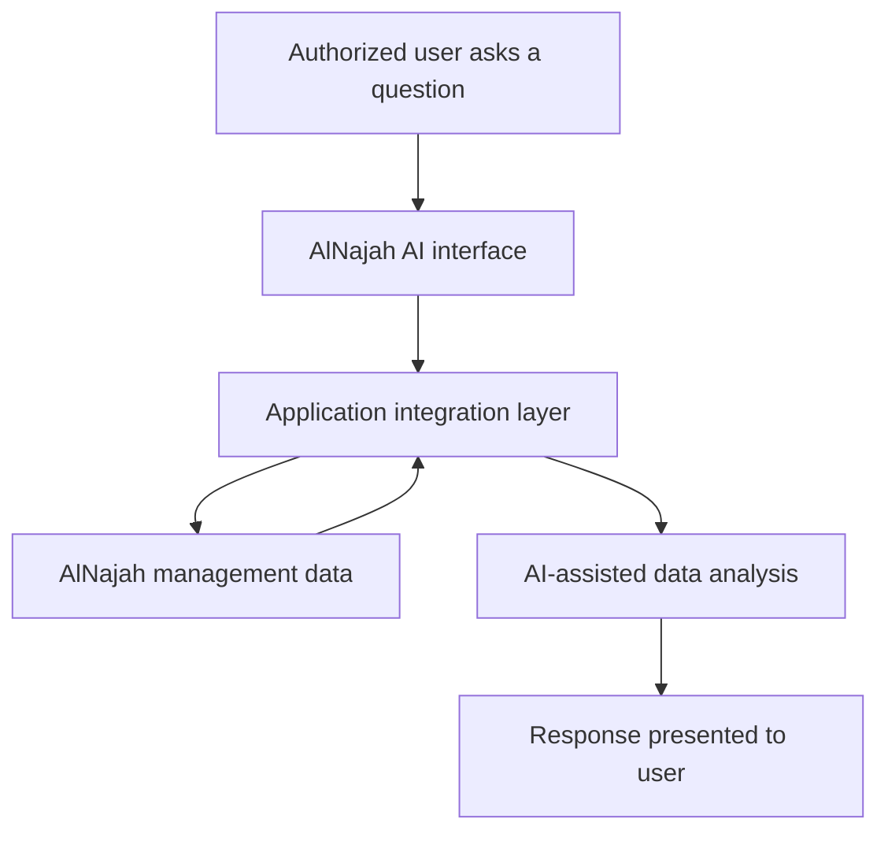

# AlNajah AI

**AI-Powered Data Assistant for School & Institute Management**

> **Commercial project showcase** — this repository documents the project at a high level. The proprietary application, integration code, internal workflows, credentials, and real student or institutional data are **not** included.

## Overview

**AlNajah AI** is an intelligent assistant integrated with **AlNajah**, a school and institute management system. It helps authorized users explore information already managed by the system through natural-language questions and receive understandable, data-informed responses.

The goal is to make institutional and administrative data easier to interpret without requiring users to manually navigate numerous screens or reports.

## Key Capabilities

- **Natural-language questions:** Ask about information available within the connected school and institute management system.
- **System-data integration:** Connect AI-assisted interactions to relevant management data.
- **Data analysis:** Turn retrieved records into understandable summaries and insights for administrative workflows.
- **Conversational experience:** Let users ask questions instead of relying only on conventional report navigation.
- **Context-aware responses:** Present answers based on the relevant data returned by the integrated system.

*Exact data categories, integrations, and supported analyses depend on the deployment and its access permissions.*

## High-Level System Flow

This diagram describes the **functional flow**, not the implementation or private infrastructure. It intentionally omits internal endpoints, database schemas, and proprietary processing details.

## Engineering Focus

| Area | Focus |
| --- | --- |
| Business integration | Connecting an AI assistant to an existing education-management product |
| Structured data | Retrieving and interpreting relevant institutional records |
| AI integration | Natural-language interaction with business data |
| User experience | Turning management data into readable answers and summaries |
| Software delivery | Integrating a usable AI workflow into an existing software ecosystem |

## My Contribution

**Independently developed AlNajah AI**, including the AI-assistant experience and its integration with the AlNajah management system. AI-assisted development tools were used as part of the engineering workflow.

## Screenshots & Demo

Screenshots or demonstrations may be added here after removing or replacing all identifiable information with **synthetic data**. No real student, parent, employee, grade, payment, or institutional records are published in this repository.

## Project Availability

- **Type:** Commercial / proprietary software
- **Source code:** Private
- **Public repository purpose:** Portfolio case study only

## Developer

**Ahmad Darwish** — Software Engineer | Node.js & React | AI Integration

- [Portfolio](https://ahmaddarwish-dev.github.io/)
- [GitHub](https://github.com/ahmaddarwish-dev)
- [LinkedIn](https://www.linkedin.com/in/ahmad-darwish-2012b1423/)

---

*This repository is an overview of a commercial product, not a public release or a claim that the proprietary source code is available.*
